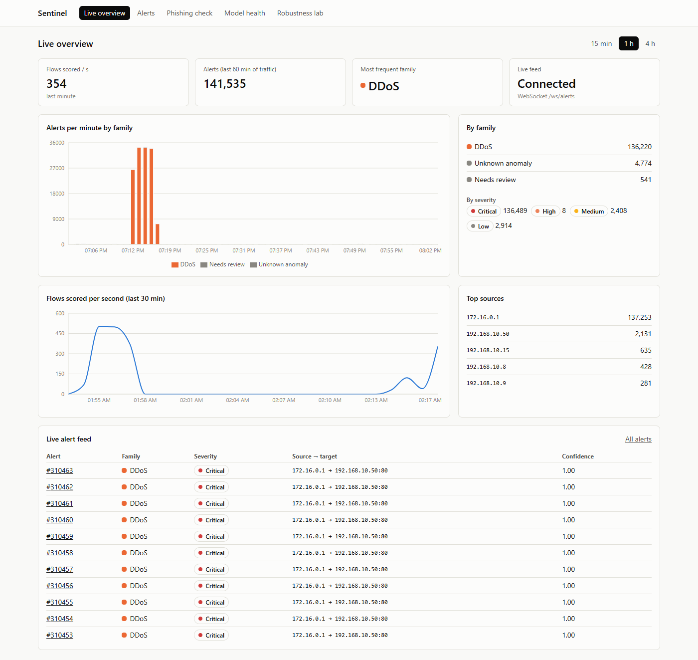
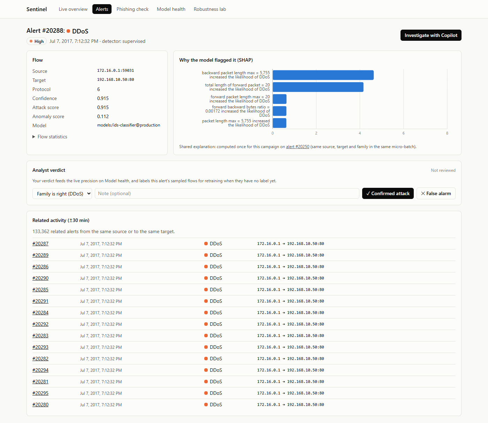
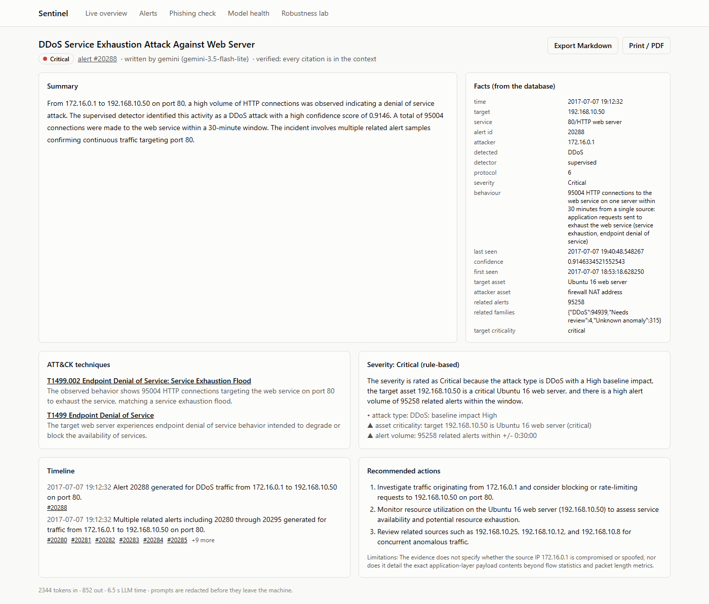
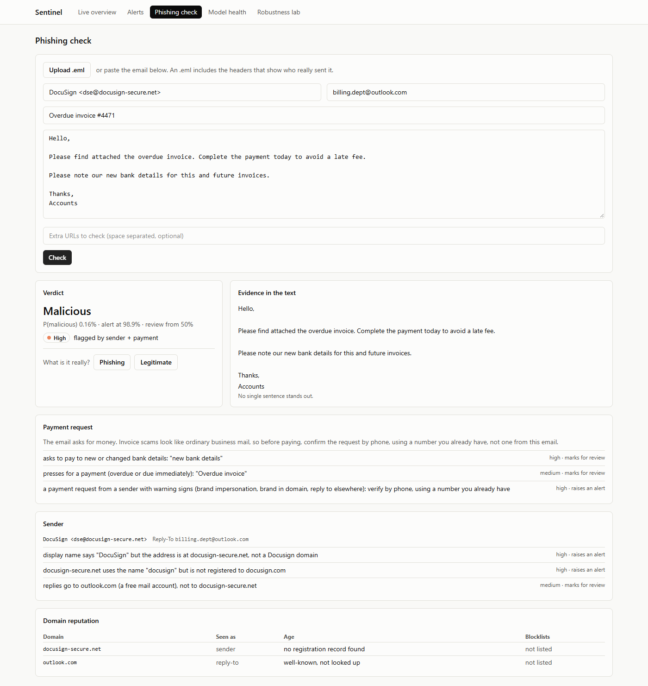
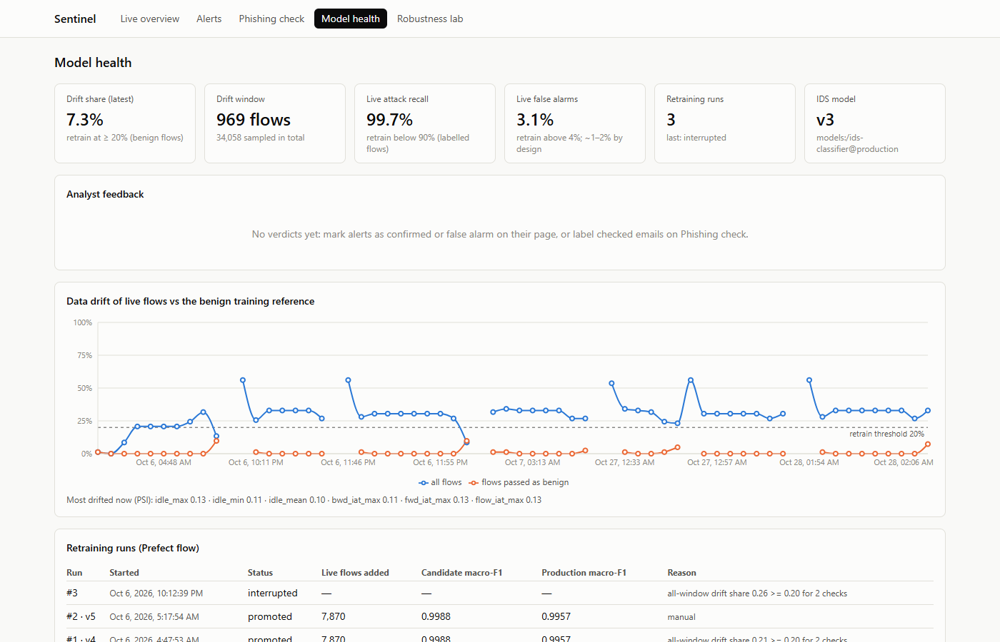

# Sentinel

**A Security Operations Center that runs on a laptop: machine learning that detects network
attacks and phishing, an LLM copilot that writes cited incident reports, and the MLOps that
keeps both honest.**

[](https://github.com/sreevidhuyarra/sentinel/actions/workflows/ci.yml)

[](LICENSE)
[](https://sreevidhuyarra-sentinel.hf.space/app/)

**[Try the live demo →](https://sreevidhuyarra-sentinel.hf.space/app/)** Browse recorded alerts
and the copilot's reports, and check your own emails for phishing. It runs read-only on
Hugging Face Spaces ([what the demo turns off](docs/platform.md#public-demo-hugging-face-spaces)).



Sentinel streams network traffic through ML detectors, catches known and never-seen attacks,
checks emails for phishing and invoice fraud, explains every alert, and hands alerts to an
LLM copilot that investigates them and writes a cited incident report. The detectors are
attacked and hardened, and drift detection, retraining and promotion are automated.

Every number below comes from a test split that is later in time than all training data,
with every choice made on validation first.

## Highlights

- **Intrusion detection:** macro-F1 **0.9957** across 7 attack families, with **3** false
  alarms in 286,833 benign test flows. Every alert is explained with SHAP.
- **Unknown attacks:** an autoencoder catches **92%** of an attack family it never saw in
  training, where the supervised model catches 0%.
- **Phishing:** F1 **0.944** at **0.31%** false alarms, on top of sender, domain-reputation and
  payment-request checks whose false-alarm rates are measured before they may raise alerts.
- **SOC copilot:** ATT&CK technique precision@1 **87%**, **100%** valid citations, and
  prompt-injection success cut from 20.8% to **0%**.
- **Adversarial robustness:** realistic evasion (padding and delays) drops from **20.8%** to
  **3.5%** with a model-disagreement review flag.
- **MLOps:** about **1,440 flows/s** on a laptop CPU (detector alone), drift-triggered retraining, and a
  statistical promotion gate, added after it caught a data leak in its own retraining loop.

## Where to look, by role

| If you work in… | Start here |
|---|---|
| **SOC analysis** | The [dashboard](#screens): alert triage with explanations, [copilot incident reports](docs/copilot.md), [phishing verdicts](docs/phishing.md), and analyst feedback that feeds back into the models |
| **Detection engineering** | Detection logic with measured false-alarm budgets: [IDS](docs/ids.md), [unknown-attack detection](docs/anomaly.md), [sender, blocklist and invoice-fraud rules](docs/phishing.md), ATT&CK mapping, [evasion testing](docs/adversarial.md) |
| **ML / security engineering** | [Models and their failure modes](docs/ids.md), [adversarial robustness](docs/adversarial.md), the [prompt-injection guard](docs/copilot.md), and an honest [cross-network study](docs/ids.md) |
| **MLOps** | [DVC pipelines, MLflow registry, drift detection, Prefect retraining with a bootstrap promotion gate, Prometheus and Grafana](docs/platform.md), CI and Docker |

## Screens

| | |
|---|---|
|  |  |
| **Alert detail:** why the model flagged it, related activity, and the analyst's verdict | **Copilot report:** written by an LLM, with every citation checked against the evidence |
|  |  |
| **Phishing check:** an invoice scam the text model scores 0.16% is caught by the sender and payment checks | **Model health:** drift, live performance, analyst precision and retraining history |

## What went wrong, and what it taught

The failures were documented as carefully as the wins:

- **The retraining loop leaked test data.** The first drift-triggered retrain reported macro-F1
  0.9957 → 0.9988 and promoted itself. The replayer streams the test split, so the candidate
  had been scored on flows it had just trained on. The fix: drop overlapping rows before
  evaluating, roll back, and require a paired bootstrap to show a real gain before promotion.
- **0.9957 on one network does not transfer to another.** On UNSW-NB15 the same models score
  ROC-AUC 0.55–0.68. Removing shortcut features and training on two networks did not fix it
  (≤ 17% of attacks caught at 1% false alarms). Reported, not hidden.
- **A drift alarm can mean "different traffic", not "worse model".** A demo retrain fired on a
  changed attack mix while the detector still caught 99.8% of attacks. The trigger now watches
  the benign traffic and live performance instead.
- **Modern phishing is harder than benchmark phishing.** On a held-out set of recent real
  phishing, the text and link models alert on 74.9% (77.7% on the older benchmark). A flaw in one sender rule was found on the test split and is
  reported unpatched, because fixing it there would make the test score meaningless.
- **Invoice fraud reads like normal business mail.** The text model scores it as safe. Rules
  now flag payment requests, but there is no invoice-fraud test data, so no detection rate is
  claimed.

## How it fits together

```
 replayed network flows (CIC-IDS2017)                emails and links (dashboard or API)
                 |                                                  |
         Redpanda: net.flows                           M3  phishing: DeBERTa-v3 LoRA (ONNX)
                 |                                         + URL model (LightGBM)
 M6  stream detector, one fused verdict per flow:
     M1  supervised IDS (LightGBM + MLP ensemble, SHAP reasons)
     M2  autoencoder -> "Unknown anomaly"
     M4  review flag (the two models disagree)
                 |
         Postgres: alerts ---------------> M5  SOC copilot: LangGraph, ATT&CK + KEV hybrid RAG,
                 |                             injection guard -> cited incident report
                 |                             (Gemini, with redaction; Ollama offline)
     +-----------+---------------------+---------------------------------------+
     |                                 |                                       |
 M6  FastAPI + React dashboard     M6  Prometheus + Grafana          M6  drift watcher (Evidently)
     (live alert feed, reports,        (throughput, latency,             + live performance
      phishing, robustness)             drift, live recall)               -> Prefect retrain -> MLflow
                                                                          (bootstrap promotion gate)
```

## Results by module

Every number comes from a test split that is later in time than all training data. Every
choice was made on validation, and the test split was scored once.

| Module | What it does | Headline result |
|---|---|---|
| 1. Supervised IDS | Labels each flow as Benign or one of 7 attack families and explains the verdict | Macro-F1 **0.9957**. **3** false alarms in 286,833 benign test flows; attack recall 99.6%. Does not transfer to another network (UNSW-NB15 ROC-AUC 0.55–0.68), and neither removing shortcut features nor training on two networks fixes that (≤ 17% of attacks caught at 1% false alarms). |
| 2. Anomaly detection | Flags traffic unlike normal, catching attacks nobody labelled | Autoencoder ROC-AUC **0.943**. With a family held out of training, it catches **92%** of Infiltration and **100%** of Bot flows; the supervised model catches 0%. Web attacks stay invisible at flow level (2%). |
| 3. Phishing | Classifies emails, explains them by sentence, and checks links | F1 **0.944** at **0.31%** false alarms (PR-AUC 0.997). The ONNX model is 273 MB and takes 129 ms per email on CPU. The URL checker has 0.09% false alarms and catches ~39% of malicious links. |
| 4. Adversarial robustness | Attacks the detectors under a realistic threat model, then hardens them | Padding and delay evade the deployed ensemble **20.8%** of the time; the review flag cuts this to **3.5%** at the cost of 1.4% of benign flows sent for review. Bot traffic is the weak spot (94% evades without the flag). |
| 5. SOC copilot | Turns an alert into a cited incident report | ATT&CK technique precision@1 **87.0%** (target ≥ 70%). Citations **100%** valid, faithfulness 92.6%. Prompt-injection success falls from 20.8% to **0%** with the guard. |
| 6. Streaming + MLOps | Live detection, monitoring, drift-driven retraining and a dashboard | About **1,440 flows/s** on a laptop CPU, and p95 scoring time **48.6 ms** per 500-flow batch (target < 50 ms), both with the detector alone. With the whole stack on the same laptop it averages ~84 ms per ~320-flow batch. Retraining evaluation excludes replayed flows, which a caught leak showed was needed, and promotion requires a significant gain. |

Full tables, the studies behind them and what went wrong: [data](docs/data.md) · [IDS](docs/ids.md) · [anomaly](docs/anomaly.md) · [phishing](docs/phishing.md) · [adversarial](docs/adversarial.md) · [copilot](docs/copilot.md) · [streaming, MLOps, dashboard and API](docs/platform.md).

## Getting started

Requirements: Python 3.12, [uv](https://docs.astral.sh/uv/), Docker Desktop, ~10 GB disk,
16 GB RAM (32 GB comfortable). No GPU needed.

```bash
git clone https://github.com/sreevidhuyarra/sentinel.git && cd sentinel
cp .env.example .env
uv sync
uv run pre-commit install

docker compose up -d --wait        # Postgres :5432, MLflow :5000, Redpanda :19092
uv run sentinel data download      # corrected CIC-IDS2017, ~330 MB zip -> 1.1 GB CSV
uv run sentinel ids cross-dataset --download   # optional: fetch CIC-UNSW-NB15 (1.8 GB)
uv run dvc repro                   # data (~30 s), IDS (~20 min), anomaly (~50 min), cross-dataset (~15 min)
uv run sentinel serve              # API on http://127.0.0.1:8000 (docs at /docs)
```

No data yet? `uv run sentinel data synth` writes a small synthetic dataset in the same
format; the test suite and CI use it.

## Common commands

| Task | Command |
|---|---|
| Fast tests | `uv run pytest -m "not slow"` |
| Lint / format / types | `uv run ruff check src tests` · `uv run ruff format src tests` · `uv run mypy` |
| Rebuild data and models | `uv run dvc repro` |
| Metrics of the last run | `uv run dvc metrics show` |
| Train only (quick, 10% sample) | `uv run sentinel ids train --sample dev` |
| Hyperparameter search | `uv run sentinel ids tune --family lightgbm` |
| Imbalance study | `uv run sentinel ids imbalance` |
| Cross-dataset test | `uv run sentinel ids cross-dataset [--download]` |
| Anomaly detector + studies | `uv run sentinel anomaly train` |
| Adversarial robustness study | `uv run dvc repro -s robustness` (or `uv run sentinel adversarial run`) |
| Fill the alerts table | `uv run sentinel alerts load` |
| Investigate an alert | `uv run sentinel copilot investigate <id> [--provider ollama]` |
| Copilot evaluation / red team | `uv run sentinel copilot evaluate` (resumable) · `uv run sentinel copilot redteam` |
| Serve the API | `uv run sentinel serve` |
| Stream: detector / replay | `uv run sentinel stream detect` · `uv run sentinel stream replay --days friday --rate 500` |
| Drift check / watcher / retrain | `uv run sentinel mlops drift-check` · `mlops drift-watch` · `mlops retrain` |
| Dashboard (dev server) | `cd frontend && npm ci && npm run dev` (http://localhost:5173/app/) |
| Everything in containers | `docker compose --profile app up -d --build` |
| Infra up / down | `docker compose up -d --wait` · `docker compose down` |

On Linux/macOS/WSL, the `Makefile` wraps the common ones (`make check`, `make data`, `make up`).

## Data and credits

- Network traffic: the corrected [CIC-IDS2017](https://intrusion-detection.distrinet-research.be/CNS2022/) release by Engelen et al. (DistriNet, KU Leuven); cross-network tests on CIC-UNSW-NB15 and CSE-CIC-IDS2018 from the same group. Details: [docs/data.md](docs/data.md).
- Modern phishing: [Phishing Pot](https://github.com/rf-peixoto/phishing_pot) by rf-peixoto (CC BY-NC 4.0), used locally and never committed.
- Blocklists: [Phishing.Database](https://github.com/Phishing-Database/Phishing.Database) (MIT) and the [OpenPhish](https://openphish.com) community feed.
- Threat knowledge: MITRE ATT&CK and CISA's Known Exploited Vulnerabilities catalogue.

The code is MIT-licensed ([LICENSE](LICENSE)). Datasets and feeds keep their own licences.

## Repository layout

```
src/sentinel/
  common/     config (params.yaml + .env), JSON logging
  data/       download, ingest, columns, clean, labels, splits, features, schemas, pipeline, synthetic
  ids/        Module 1: dataset, models/ (linear, gbm, mlp), weights, calibration, decision,
              explain, metrics, bundle, registry, train, tune, imbalance, report
  anomaly/    Module 2: autoencoder, iforest, evaluate, bundle, registry, train, report
  phishing/   Module 3: text model (export, explain), URL model, sender checks, domain intel
              (blocklists, RDAP), payment checks, and the evaluations that set their roles
  adversarial/  Module 4: threat (constraints, pad/delay), attacks (ART), defenses, run, report
  copilot/    Module 5: graph, tools, rag, kb, guard (+ data, training), severity, prompts,
              models, gold, evaluate, redteam, report, service
  llm/        provider interface: gemini, ollama, cache + throttle + fallback, redact, factory
  db/         alerts / alert_truth / reports / feedback schema and the alert loader
  detection/  fusion.py: supervised + anomaly -> one verdict ("Unknown anomaly", review flag)
  stream/     Module 6: replayer, stream detector, messages, Prometheus metrics
  mlops/      Module 6: drift (Evidently), watch (trigger), retrain (Prefect flow)
  services/   api.py (FastAPI: scoring, alerts, copilot, WebSocket, dashboard), dashboard.py,
              feedback.py (analyst verdicts), metrics.py, auth.py (optional Basic auth)
  cli.py      `sentinel` command; each pipeline subcommand is a DVC stage
tests/        unit/, data/ (pipeline on synthetic data), model/ (training, registry, API)
docs/         one page per module (full results and studies); images/ (screenshots)
reports/      generated results per module (tables, model cards, figures, studies)
dvc.yaml      reproducible pipeline; params.yaml holds every tunable
frontend/     React dashboard (Vite; built into frontend/dist, served at /app/)
monitoring/   prometheus.yml, Grafana provisioning and dashboard (build_dashboard.py)
scripts/      drift_demo.ps1
docker-compose.yml   Postgres, MLflow, Redpanda, Prometheus, Grafana; profiles "app" (api,
                     detector, drift) and "demo" (replayer)
Dockerfile    one image for every service (dashboard built in a Node stage)
```
